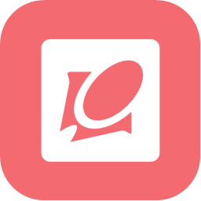
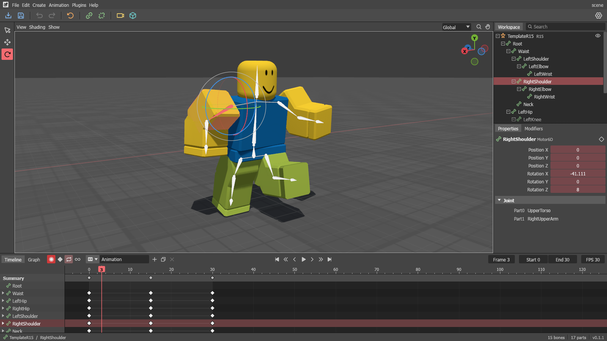
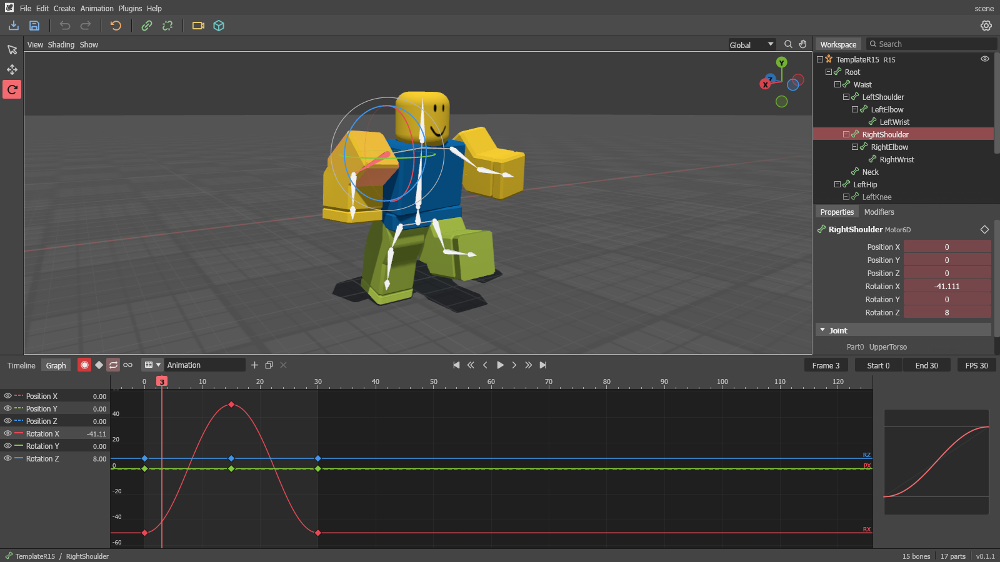
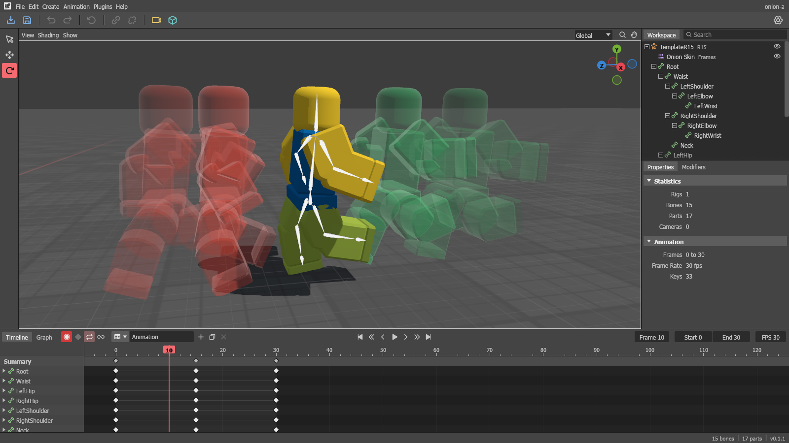
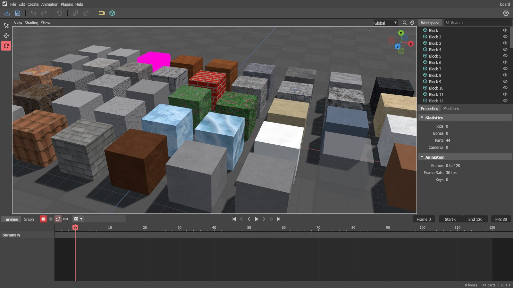

<div align="center">
  
  <h1>Kaye</h1>
  <p>A Blender-style animation tool for Roblox rigs</p>
  <p>
    <a href="https://github.com/Toorium/Kaye/releases/latest"></a>
    <a href="https://github.com/Toorium/Kaye/releases"></a>
    <a href="LICENSE"></a>
    
  </p>
  <p>
    <a href="https://github.com/Toorium/Kaye/releases/latest"><b>Download</b></a>
    ·
    <a href="https://github.com/Toorium/Kaye/releases">All releases</a>
    ·
    <a href="https://github.com/Toorium/Kaye/issues">Report a bug</a>
  </p>
</div>



Kaye is a free animation program made only for Roblox. You bring in a rig from Studio, pose it and key it on a timeline the way you would in Blender, then take the animation back into Studio.

It doesn't model, sculpt or render. Everything in it is for rigging, posing and animating Roblox characters, so a first-time animator has less to learn, and someone coming from Blender will find the controls they already know: G and R to move and rotate, `R R` to tumble, auto-smooth Bezier curves and a dark 3D view.

## Features

**Rigs from Studio**

- Opens `.rbxm` and `.rbxmx` files: R6, R15, Rthro, custom Motor6D rigs and skinned rigs
- Brings in animations already saved in a rig's `AnimSaves`
- Shows real meshes and textures once you give it a Roblox Open Cloud key, and Roblox's own materials with no key at all

**Posing**

- On-screen handles, Blender's G and R keys, or typed numbers, with undo for all of it
- Box select, and moving or turning several bones at once
- IK with poles and bend limits on R6, R15 and custom rigs, plus Look At, Copy Bone, Limit Rotation, Inherit Rotation and Ragdoll
- Switching a limb between IK and FK, or unparenting it, without it moving
- Copy, paste and mirror poses

**Animating**

- Timeline with per-axis keys, playback, loops and Smooth Loop
- Auto-smooth Bezier curves by default, and every Roblox easing style from a right click
- A Graph Editor where you drag keys and handles on every channel
- Onion skins, motion paths, and any number of animations per rig
- Cameras you can animate, field of view included, with a corner preview

**Back to Roblox**

- Exports a `KeyframeSequence`, on its own or inside the rig's model
- Drag rigs, cameras and shapes from the Workspace straight into Studio

**Everything else**

- `.kaye` project files, and a backup of your work every 5 minutes
- Studio and Shaded lighting, themes where every color can be changed, and rebindable keys
- Luau plugins from a Plugins menu
- Tells you when a new version is out, and updates itself

<table>
  <tr>
    <td width="33%"></td>
    <td width="33%"></td>
    <td width="33%"></td>
  </tr>
  <tr>
    <td align="center">Graph Editor</td>
    <td align="center">Onion skins</td>
    <td align="center">Roblox materials</td>
  </tr>
</table>

## Download

Get `Kaye-<version>.msi` from the [latest release](https://github.com/Toorium/Kaye/releases/latest) and run it. Nothing needs building. It installs for your Windows account only, in `%LOCALAPPDATA%\Programs\Kaye`, so it doesn't ask for administrator rights.

Kaye isn't code signed yet, so Windows may say it protected your PC. Click **More info**, then **Run anyway**.

If you'd rather not install anything, `kaye.exe` on the same page is the whole program and runs from any folder.

From 0.1.1 on, Kaye checks for a new version when it starts. Click **Update** and it closes, downloads only the files that changed, and opens again. Your projects, settings and backups aren't touched.

### Requirements

- Windows 10 or 11, 64-bit
- A graphics card with Direct3D 12, Vulkan or OpenGL

## Getting started

1. Open Kaye. It asks for a Roblox Open Cloud API key and walks you through making one, which takes about a minute. Without a key, rigs still open, but their parts show as plain grey boxes. The key stays on your computer, in Windows Credential Manager.
2. In Studio, right-click your rig and pick **Save to File** to get a `.rbxm`.
3. Drag that file onto Kaye's window, or use the Import button.
4. Animate. Auto Key is on, so posing a bone keys it on the current frame.
5. Use **File > Export > .rbxm > Rig** for the rig with its animations in `AnimSaves`, or **Keyframe** for the animation alone, and drop the file into Studio.

## Building from source

You need the latest stable [Rust](https://rustup.rs), and the Visual Studio C++ build tools, since the Luau plugin runtime is C++.

```bash
git clone https://github.com/Toorium/Kaye.git
cd Kaye
cargo run --release
```

Run the tests:

```bash
cargo test
```

Build the installer, which needs [WiX 3](https://github.com/wixtoolset/wix3/releases) and lands in `dist\`:

```bash
powershell -ExecutionPolicy Bypass -File scripts\build-installer.ps1
```

Publish a release, after raising the version in `Cargo.toml` and committing:

```bash
powershell -ExecutionPolicy Bypass -File scripts\publish-update.ps1 -Notes "What's new"
```

## Project status

Kaye is early. Releases are test builds, and things will break. If something does, an [issue](https://github.com/Toorium/Kaye/issues) with the `.rbxm` you used helps the most.

- Windows only for now. Mac and Linux builds have never been tried.
- On some rigs, shirts and pants don't show and hats don't follow the head. That's being fixed.
- Exported animations haven't all been checked in Studio yet, and a camera's animated field of view doesn't export.
- Decals only show on plain blocks, and ragdolls don't collide with themselves.

## Credits

Kaye is built on [egui](https://github.com/emilk/egui) and [wgpu](https://github.com/gfx-rs/wgpu), reads and writes Roblox files with [rbx-dom](https://github.com/rojo-rbx/rbx-dom), and runs plugins with [mlua](https://github.com/mlua-rs/mlua) and [Luau](https://github.com/luau-lang/luau). Icons are from [Phosphor](https://phosphoricons.com) under the MIT license.

## License

Kaye is released under the BSD 3-Clause License. See [LICENSE](LICENSE).

Kaye is a fan-made tool and isn't affiliated with or endorsed by Roblox Corporation. Roblox and Roblox Studio are trademarks of Roblox Corporation.
